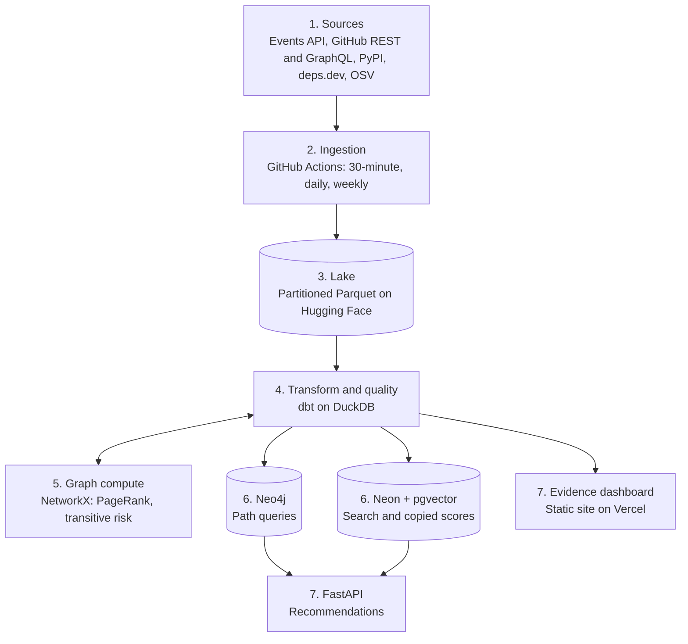

# Faultline: Project Plan

| | |
| --- | --- |
| **Project** | Faultline (open-source package health and supply-chain risk) |
| **Author and owner** | Dhatri Neerja |
| **Version** | 1.1 |
| **Date** | 2 November 2026 |
| **Status** | Stage 0 done. Stage 1 built and loaded (Events API job on a 30-minute schedule, 6-month backfill and PyPI history uploaded); its 7-day run checkpoint is in progress. Stage 2 built (dbt models, 29 tests, score v1); score coverage is 91.1% against the 95% target. Stage 3 is next. |

Stages 1 and 2 are built; everything from Stage 3 onward is still a plan. Costs, limits and timelines for stages not yet built are planning estimates, and the items in [section 17](#17-open-items) must be confirmed before they are relied on. Version 1.1 changed the data sources after GH Archive was measured and found incomplete (see sections 9 and 14).

## Contents

1. [Executive summary](#1-executive-summary)
2. [Problem statement](#2-problem-statement)
3. [Need and stakeholders](#3-need-and-stakeholders)
4. [Objectives and success criteria](#4-objectives-and-success-criteria)
5. [Scope](#5-scope)
6. [Differentiators and related work](#6-differentiators-and-related-work)
7. [Product capabilities](#7-product-capabilities)
8. [Technology stack](#8-technology-stack)
9. [System architecture](#9-system-architecture)
10. [Key design decisions](#10-key-design-decisions)
11. [Roadmap](#11-roadmap)
12. [Evaluation methodology](#12-evaluation-methodology)
13. [Risks and mitigations](#13-risks-and-mitigations)
14. [Data sources](#14-data-sources)
15. [Project metrics](#15-project-metrics)
16. [Resources, ethics and licensing](#16-resources-ethics-and-licensing)
17. [Open items](#17-open-items)
18. [References](#18-references)

## 1. Executive summary

Faultline scores the health of open-source packages from real project activity, finds the risk hidden deep in their dependency trees, and recommends what to use with a plain-language reason. It tests the score with a published backtest against simple baselines.

Version 1 covers about 2,000 PyPI packages, refreshed about every 30 minutes, at a planned running cost of $0 on free tiers. The build is planned in eight gated stages over about 10 to 14 weeks at 10 to 15 hours a week.

The project's central claim is expressed as a testable hypothesis: a score that combines activity signals with dependency-graph risk flags packages that are abandoned within 6 to 12 months with higher precision and recall than stars, commit recency or OpenSSF Scorecard alone.

## 2. Problem statement

Teams choose and keep open-source dependencies using popularity signals such as stars and downloads, which say nothing about whether anyone still maintains them. Existing health tools score one repository at a time, so risk that lives further down the dependency chain, or with one overstretched maintainer, stays invisible until something breaks.

The project answers four questions, each a different kind of analysis:

| Question | Analysis type | What answers it |
| --- | --- | --- |
| Is this package healthy, and which way is it trending? | Descriptive and diagnostic | Health metrics, cohorts, funnels, trends, anomaly flags |
| Where does risk hide in what I already depend on? | Network analysis | Knowledge graph: transitive risk, maintainer concentration, blast radius, licence conflicts |
| What should I use for this need? | Prescriptive | Search, filter, weighted rank, explanation |
| Does the score predict anything real? | Validation | Backtest against stars, last-commit recency and OpenSSF Scorecard |

## 3. Need and stakeholders

Organisations run on open-source software but usually notice trouble only after a project breaks or goes quiet. Three well-known incidents show the pattern:

- **left-pad (2016):** one maintainer unpublishing an 11-line npm package broke builds across the industry.
- **Log4Shell (2021, CVE-2021-44228):** a critical flaw in a logging library that many teams did not know they depended on, because it arrived transitively.
- **xz backdoor (2024, CVE-2024-3094):** an attacker spent years gaining the trust of the overstretched maintainer of a compression library used across Linux.

Each is a dependency-chain or maintainer-concentration problem, which is what per-repository scores miss.

| Stakeholder | Their question | What Faultline provides |
| --- | --- | --- |
| Engineering leaders | Which library should we adopt, and is our current stack still safe? | Ranked recommendation with reasons; stack risk view |
| Security teams | If package X is abandoned or compromised, what is affected? | Blast-radius query on the graph; open advisories |
| Developer-tool investors | Which projects are rising or quietly declining? | Trend and momentum views; early decline flags |

Software supply-chain requirements, such as SBOM expectations in the United States and the EU Cyber Resilience Act, are also pushing teams to know what they depend on, not only what they import directly.

## 4. Objectives and success criteria

| Objective | Success criterion |
| --- | --- |
| Measure package health | Score present for at least 95% of mapped packages; every score carries its formula version |
| Reveal hidden risk | Transitive risk and blast-radius queries return for every tracked package |
| Recommend with reasons | 20 written test queries return sensible top 3 results; every explanation sentence traces to a score component |
| Prove the score | Backtest published with precision and recall against every baseline, with and without the graph term |
| Operate reliably at no cost | About 30-minute refresh at $0 running cost; failures alert, and the site keeps the last good data |

## 5. Scope

**In scope for version 1**

- PyPI packages that have a GitHub repository.
- Package-level dependencies, not version-level.
- Public data only.

**Out of scope for version 1**

- Other ecosystems such as npm and Maven.
- Private repositories.
- Real-time streaming.
- Acting as a vulnerability scanner.
- Per-person scores of maintainers.

## 6. Differentiators and related work

Several tools already score open-source projects, so a plain health dashboard would add little. Faultline is only worth building if it keeps these five differences, which is why the knowledge graph and the backtest are required parts of the plan.

1. **Transitive risk.** The graph shows a healthy-looking package that depends on a low-activity one three levels down. Per-repository scores cannot show this.
2. **Maintainer concentration.** The graph shows when one person maintains several critical packages, and what is affected if they step away.
3. **A recommendation with a reason.** A user describes a need and receives a ranked answer with its reasoning, from a transparent weighted score.
4. **A backtested score.** The project publishes how often the score warned about packages that were later abandoned, against simple baselines.
5. **A reproducible score.** Every score carries its formula version, and the formula is open, so anyone can recompute and challenge it.

The table below is from a preliminary survey. Each tool's current features must be checked before these comparisons are presented as fact ([section 17](#17-open-items)).

| Existing tool | What it does | Gap Faultline addresses |
| --- | --- | --- |
| OpenSSF Scorecard | Checks security practices of one repository | No activity trends, dependency-chain view or recommendations |
| deps.dev (Google) | Shows dependency graphs, advisories and Scorecard data per package | No maintainer-health score, ranked recommendation or backtest |
| ecosyste.ms | Indexes packages, dependents and metadata across ecosystems | Raw data, not a health judgment or recommendation |
| Cauldron.io (Bitergia) | Hosted CHAOSS-based analytics | Per-repository view; no transitive risk or recommendations |
| LFX Insights (Linux Foundation) | Health dashboards for projects | Per-project view; dependency-chain coverage to be checked |
| Snyk and Aikido package health | Package health signals inside security products | Closed scoring; transitive maintainer risk and backtests to be checked |
| org-metrics-dashboard (GitHub) | Dashboard of one organisation's repositories | Single organisation; no ecosystem ranking or recommendation |
| Stars and download counts | Popularity | Say nothing about whether maintainers are still present |

## 7. Product capabilities

### 7.1 Health tracking

The health score combines eight components. Each is converted to a 0 to 100 percentile within the tracked set, then combined by weight. Weights are a version 1 starting point, may be tuned only on the training window of the backtest, and any change creates a new formula version. The machine-readable formula is in [config/score_v1.toml](config/score_v1.toml), and measurement rules are in [docs/definitions.md](docs/definitions.md).

| Component | Definition (90-day window unless stated) | Start weight |
| --- | --- | --- |
| Maintainer activity | Distinct people who merged, released or triaged | 20% |
| Contributor retention | Share of last window's contributors active again this window | 15% |
| Responsiveness | Median hours to first maintainer response on issues and PRs | 15% |
| Dependency risk (graph) | Worst health among dependencies, discounted by depth | 15% |
| PR flow | Share of PRs merged or closed within 30 days | 10% |
| Release recency | Days since the last PyPI release | 10% |
| Bus factor | Fewest people who made 50% of commits in 12 months | 10% |
| Open vulnerabilities | Unfixed OSV advisories affecting the latest release | 5% |

Dependency risk uses each dependency's own health (the score without its dependency term), which avoids a circular score:

```math
\text{Health}_v = \sum_i w_i \cdot \text{pct}(x_i), \quad \text{DepRisk}(p) = \max_{d \in \text{deps}(p)} \big(100 - \text{OwnHealth}(d)\big) \cdot 0.6^{\,\text{depth}(d)-1}
```

The dashboard also covers cohorts (contributor retention by first-contribution month), funnels (issue opened, responded, PR opened, merged), anomaly flags on sudden drops, and rising projects.

### 7.2 Hidden risk (knowledge graph)

The graph links packages, dependencies, maintainers, organisations, licences, topics and vulnerabilities. It answers questions a health table cannot:

- **Hidden risk:** a healthy-looking package that relies on a low-activity one three levels down.
- **Maintainer concentration:** one person who maintains several critical packages.
- **Blast radius:** which packages are affected if one is abandoned or compromised.
- **Licence conflicts:** a permissive package that pulls in a more restrictive licence.
- **Alternatives:** packages with similar topics, or used in similar stacks.
- **Criticality:** PageRank over the dependency graph shows which packages the ecosystem leans on most, so a decline there matters more.

### 7.3 Recommendation

A user enters a need such as "Python library for parsing PDFs, MIT licence, for a commercial product."

1. **Find:** match the need against READMEs, descriptions and topics by meaning, using vector search.
2. **Filter:** remove poor fits such as the wrong language or licence.
3. **Rank:** score the remainder on health, adoption, dependency risk and known vulnerabilities with a transparent weighted score.
4. **Explain:** state the reasoning, for example "Pick A: active maintainers and broad adoption. Avoid B: one maintainer, and it relies on an abandoned package."

Explanations are built from templates filled with score components, not from a language model. Templates are free, testable and cannot invent facts. A language model may be added later as an optional rewrite layer, given only those facts.

## 8. Technology stack

Every choice runs on a free tier and has a named alternative for larger scale. Limits are planning figures to confirm in each provider's dashboard; [docs/free-tier-limits.md](docs/free-tier-limits.md) tracks that check.

| Layer | Choice | Rationale | Alternative at scale | Limit to plan for |
| --- | --- | --- | --- | --- |
| Sources | GitHub Events API (current activity), GitHub REST and GraphQL API (the 6-month backfill, backtest history and metadata), PyPI, deps.dev, OSV | Public and free; together they cover activity, dependencies and vulnerabilities | Paid data feeds, private registries | GitHub API rate limits |
| Orchestration | GitHub Actions on a cron | No server to run; logs, secrets and retries built in | Airflow or Dagster | Schedules can start late; can be disabled after long repository inactivity |
| Processing | DuckDB and Python | Reads compressed JSON and Parquet fast on one machine | Spark or BigQuery | Runner disk and memory; the Stage 6 history load is paged by repository and date range |
| Transformation | dbt (dbt-duckdb) | SQL models with tests, documentation and lineage | Same tool on a warehouse | None material |
| Data quality | dbt tests and Pandera-style checks | Catches broken loads before they reach users | Great Expectations, Soda | None |
| Lake | Date-partitioned Parquet in a Hugging Face dataset | Columnar, permanent and versioned, unlike Actions and Space disks | S3 or GCS with Iceberg or Delta | Dataset size guidance |
| Graph | Neo4j AuraDB Free; PageRank in NetworkX | Variable-length path queries in Cypher are short and readable | Neo4j paid, or Memgraph | 50,000 nodes and 175,000 relationships; pauses after 3 idle days |
| Search | pgvector on Neon Postgres; fastembed on CPU | Vector search and SQL filters in one query | Dedicated vector database only if the corpus grows greatly | About 500 MB storage |
| API | FastAPI in Docker on Hugging Face Spaces | Typed, fast, auto-generated documentation | Cloud Run, Fly.io | 2 vCPU, 16 GB; sleeps after 48 h idle; disk not persistent |
| Dashboard | Evidence.dev static site on Vercel | SQL-in-Markdown pages built from Parquet; survives pipeline failures | Superset, Metabase | Rebuild after each refresh |
| Optional ML | Free GPU notebooks; BERTopic | Only for embedding READMEs at scale or topic clustering | Managed GPU jobs | Session time limits |

**Storage estimate.** 2,000 packages with 384-dimension embeddings need about 3 MB, so Neon storage is not a constraint. The graph is the tightest limit: tracked packages, external dependencies, maintainers, licences and advisories should reach the low tens of thousands of nodes. This is measured at Stage 4 before the package list grows.

## 9. System architecture

Scheduled jobs build one source of truth, the Parquet lake, and copy what each live feature needs into a store suited to it. Visitors only read those copies, so no page view or API call triggers a heavy query.



Layer 8, Operations, spans the whole system: alerts, secrets management, CI and the runbook.

| # | Layer | Responsibility | Key design choice | Repository location |
| --- | --- | --- | --- | --- |
| 1 | Sources | Events API for current activity, GitHub REST and GraphQL for the 6-month backfill, backtest history and metadata, PyPI and deps.dev dependencies and licences, OSV advisories | Public data only | `src/faultline/sources/` |
| 2 | Ingestion | Three schedules: every 30 minutes (Events API, the source of current activity), daily (GitHub REST API metadata such as archived flag and contributors), weekly (PyPI metadata from Stage 2, then deps.dev and OSV from Stage 4). GH Archive is used only for the Stage 6 backfill | Load only new data; filter to tracked repositories and needed columns at read time | `src/faultline/ingestion/`, `.github/workflows/` |
| 3 | Lake | Date- and hour-partitioned Parquet; raw downloads deleted after each run | The only source of truth; every other store can be rebuilt from it | `src/faultline/lake/` |
| 4 | Transform and quality | dbt staging, intermediate and marts (daily metrics, health scores, graph edges); tests on every run | Each score row carries its formula version | `transform/` |
| 5 | Graph compute | PageRank and transitive risk computed inside the pipeline and written back into the marts | Heavy graph work runs offline | `src/faultline/graph_compute/` |
| 6 | Serving stores | Neo4j for interactive path queries; Neon for embeddings and copied scores | Each access pattern has its own store, loaded by upsert | `src/faultline/serving/` |
| 7 | Live services | FastAPI recommendation API; Evidence static dashboard | Read-only, cached; keep showing the last good data if a run fails | `src/faultline/api/`, `dashboard/` |
| 8 | Operations | Alerts, secrets in platform settings, CI running dbt tests | Overwriting by date and hour makes every re-run safe | `ops/`, `.github/workflows/` |

**Current activity and history.** The Events API feeds current activity. It returns at most 300 events or 90 days per repository, so a one-time backfill of the last 6 months from the GitHub GraphQL API covers the window metrics at launch, and the same API supplies the history for the Stage 6 backtest. Events from the API are merged into date-hour partitions by event id, so re-runs never double-count. The 12-month bus factor also uses commit history from the API. Measured on 1 to 2 November 2026: the backfill covered 1,643 of 1,647 repositories in 33 shards over four hourly allowances (about 11,000 GraphQL points as projected), with 32 repositories capped on PRs, 10 on issues and 9 on commits.

**Meaning of "live".** Everything runs in the cloud, and data refreshes about every 30 minutes rather than instantly. Streaming is excluded because it needs an always-on server, and package health does not change minute by minute.

**Recommendation request path.** The API embeds the query with fastembed and runs one Postgres query combining vector search, licence and language filters, and ordering by copied scores. It then asks Neo4j only for the top results' risk paths and fills the explanation template. The target is under one second when warm; a cold start after the Space sleeps may take tens of seconds, and the page will say so.

## 10. Key design decisions

| Decision | Rationale | Trade-off or fallback |
| --- | --- | --- |
| Three stores for 2,000 packages | Access patterns require it: time series want columnar files, multi-hop paths want a graph, similarity search wants vectors | More moving parts, contained by making the other stores rebuildable copies of the lake. Postgres recursive queries can replace Neo4j |
| Batch instead of Kafka | Package health moves over days and weeks; a 30-minute batch supports the same decisions with no always-on server | Streaming could be added at larger scale for alerts on events such as a maintainer handover |
| Idempotent writes by date and hour | A retry merges by event id or replaces its own partition and never double-counts; the saved state advances only after the data is stored, so a failed run is simply retried | Requires strict partitioning discipline |
| Blocking tests before publish | dbt tests cover keys, nulls, accepted values, row-count ranges and freshness, so bad data does not reach users | A failed test delays freshness rather than quality |
| PyPI-to-GitHub mapping with overrides | PyPI project URLs and deps.dev links, plus a manual override file | Unmapped packages are reported, never silently dropped |
| DuckDB instead of Spark | After early filtering the working data fits on one machine | The dbt SQL can move to a warehouse largely unchanged |
| Static dashboard | Rebuilt after each refresh, so it keeps working when a run fails | Data is only as fresh as the last good run, and the page shows that time |
| Template explanations instead of an LLM | Deterministic, testable and free; every sentence traces to a score component | Less natural wording |
| Versioned scores | The backtest and the live dashboard can be reproduced and compared | A new version is required for any formula change |
| Secrets outside code | API keys live in each platform's secret settings | Each platform must be configured separately |

**Path to larger scale.** Actions moves to Airflow, the Hugging Face dataset to object storage with Iceberg, DuckDB to a warehouse or Spark, and Neo4j Free to a paid graph instance. The layer boundaries stay the same.

## 11. Roadmap

Work proceeds through eight stages, and a stage starts only when the previous checkpoint passes. Stages 1 to 3 form the minimum shippable product, but that alone matches existing tools, so the knowledge graph in Stage 4 is a required stage. Week estimates assume 10 to 15 hours a week.

### 11.1 Stage checkpoints

| Stage | Build | Checkpoint to pass | Est. weeks |
| --- | --- | --- | --- |
| 0. Setup and definitions | Package list (about 2,000), repository mapping, metric definitions, "abandoned" definition, accounts and limits | Definitions committed before any data is examined; every free-tier limit confirmed in each dashboard | 1 |
| 1. Ingestion pipeline | Events API job with ETags, a one-time REST or GraphQL backfill of the last 6 months of pull requests, issues, commits and releases for tracked repositories, early filtering, Parquet lake | The first full load completes across the rate limit; the 6-month backfill covers at least 95% of tracked repositories, with its call count measured and logged; 7 straight days of runs, measured by `ops/check_stage1.py` and logged in [docs/stage-1-checkpoint.md](docs/stage-1-checkpoint.md); re-running gives identical row counts; unchanged repositories cost no rate limit; raw files deleted | 1 to 2 |
| 2. Models and score v1 | PyPI release history load, dbt staging, intermediate and marts, tests, health score v1 with formula version | All dbt tests pass; score present for 95%+ of mapped packages; spot-check of 10 known packages looks sensible | 1 to 2 |
| 3. Dashboard, live refresh, alerts (MVP) | Evidence site on Vercel, 30-minute job, failure alerts | Public URL; last-updated time shown; a deliberately broken run sends an alert and the site keeps the last good data | 1 |
| 4. Knowledge graph (required) | deps.dev and OSV loads, Neo4j model, NetworkX PageRank and dependency risk | Transitive risk and blast-radius queries return for every tracked package; node and edge counts under 80% of the cap | 2 |
| 5. Search and recommendation | fastembed embeddings in pgvector, FastAPI, filters, ranking, explanation templates | 20 written test queries return sensible top 3s; every explanation sentence traces to a score component | 2 |
| 6. Backfill and backtest | GraphQL history loaded by date range for each of the nine cutoffs from October 2023 to October 2025 (the 90 days before each cutoff, 12 months of commits for bus factor, and the 12 months after for outcomes); "abandoned" outcomes from the archived flag, releases and commits plus PyPI; backtest against baselines | Results table published with precision and recall for all baselines, with and without the graph term; repositories hitting the page caps are counted and reported | 2 to 3 |
| 7. Launch and write-up | README, related-work table, architecture diagram, write-up post | A newcomer can understand the project from the README in 5 minutes; all reported figures are measured | 1 |

### 11.2 Checkpoints per layer

| Layer | Built in stage | Done when |
| --- | --- | --- |
| Sources and ingestion | 1, 3, 4 | All three schedules run on time for a week; rate-limit headroom logged on every API run |
| Lake | 1 | Partitions by date and hour; a re-run overwrites and never duplicates; total size tracked |
| Transform and quality | 2 | Tests on keys, nulls, ranges and freshness; a failing test blocks publish |
| Graph compute and Neo4j | 4 | Counts within cap; the three-levels-down query returns real examples |
| Search (Neon) | 5 | Every tracked package has an embedding and current scores; filters work in the same query |
| API | 5 | Documented endpoints; p95 under 1 second when warm; cold start measured and shown |
| Dashboard | 3 | Rebuilds after each refresh; loads fast on mobile; shows the formula version |
| Operations | 3 | Alert tested; secrets only in platform settings; runbook for re-running a failed day |
| Evaluation | 6 | Backtest reproducible from one command and one formula version |

## 12. Evaluation methodology

The backtest tests whether the score would have warned about packages that were later abandoned, and whether recommended packages stayed healthy.

**Core rules**

1. Define "abandoned" before examining results, for example archived, deprecated, or no release or commit for 12 months.
2. Score only with data from before a cutoff date, then check the next 6 to 12 months. Later data must never leak into the score.
3. Compare against three baselines: stars alone, last-commit recency alone, and the OpenSSF Scorecard score. Report precision and recall for each.
4. Show the graph's contribution by reporting the score with and without the dependency-risk term.
5. Report misses and false alarms.

**Controls for validity**

- **Rolling cutoffs:** use several cutoffs, for example every quarter over two years, so one favourable date cannot carry the result.
- **Separate tuning and testing:** select weights on early cutoffs only, and report on later ones.
- **Base rate:** abandonment is rare, so report precision at a fixed alert budget (for example the bottom 5% of scores) and PR-AUC rather than accuracy.
- **Survivorship bias:** build the package list as it existed at each cutoff, not from the current list.
- **Lead time:** report how many months ahead the score first crossed the warning line.
- **Feature source:** the backtest builds its features from GraphQL history, while live scores add the Events API for freshness. Before reporting, compute the live features from GraphQL alone for one recent period and report how far the two differ, so the live score is not assumed to match the backtest exactly.
- **Recommendation check:** for the 20 test queries, record whether the top pick remained healthy 12 months later, against the most-starred option.

## 13. Risks and mitigations

| Risk | Impact | Mitigation |
| --- | --- | --- |
| GitHub API rate limits: 2,000 repositories every 30 minutes is about 4,000 calls an hour, near the 5,000 a personal token allows | 30-minute job fails or runs late | Conditional requests with ETags, GraphQL batching, or refreshing only the most active few hundred every 30 minutes and the rest daily |
| PyPI-to-GitHub mapping is incomplete or wrong | Missing or misattributed scores | deps.dev and PyPI links, a manual override file, and an "unmapped" report on the dashboard |
| Neo4j cap or idle pause | Graph queries fail | Stay under 80% of the cap; pipeline writes keep it awake; rebuild from the lake; Postgres fallback |
| Scheduled workflows run late or are disabled | Stale data | Show last-updated time; alert on staleness; regular commits keep the repository active |
| Score is gamed, or wrong for unusual projects | Poor advice | Transparent components, an "insufficient data" state, and published misses |
| Free-tier terms change | A component stops working | Keep the lake as the source of truth so any serving store can be replaced |
| Events API history is short (300 events or 90 days) and a long outage loses events for busy repositories | Window metrics, retention in particular, are incomplete at launch or after a gap | One-time 6-month REST backfill; alert when a run is missed; re-run the REST backfill for any gap |
| GitHub's public event feed changes again | Live scores undercount activity | Current activity comes from the Events API; the lake keeps every event; a volume check on each run alerts on a sudden fall; the 6-month and backtest history come from GraphQL, not the feed |
| Scope creep | Project never ships | Ship the Stage 3 MVP, then the graph, before anything new |

## 14. Data sources

| Source | Provides | Limitation |
| --- | --- | --- |
| GH Archive (evaluated, not used) | Every public GitHub event, in hourly files | Measured and rejected on 1 to 2 November 2026. Recent hourly files hold under 1% of the events the Events API shows for the same repositories, and an 8-hour check on 2025-09-16 found only about 49% of the pull requests GitHub reports opened (198 against 407) |
| GitHub Events API | Recent events per repository | Rate limited; returns at most 300 events or 90 days per repository, so it cannot rebuild history. This is the source for current activity. The first full load of about 1,650 repositories uses most of an hour's 5,000 calls; later runs use ETags and cost little |
| GitHub REST or GraphQL API | Repository metadata, archived flag, contributors | Rate limited |
| PyPI | Releases, project URLs, licence field | Licence field is free text and often inconsistent |
| deps.dev | Dependency graph, links, licences | No quotas or bulk-use rules are stated; the Stage 4 load is small (about 2,000 packages). Send requests gently, cache results, and email depsdev@google.com only if blocked or if the tracked set grows far larger |
| OSV | Vulnerability advisories by package and version | Coverage varies by ecosystem |

## 15. Project metrics

- **Pipeline:** run success rate, data freshness (minutes since last good load), rows in and out per run, rate-limit headroom.
- **Data quality:** test pass rate, share of packages mapped and scored.
- **Product:** API p95 latency, cold-start time, dashboard visits, recommendation queries.
- **Model:** backtest precision, recall and lead time against each baseline, by formula version.

## 16. Resources, ethics and licensing

### 16.1 Resources and cost

- **Team:** one person, at 10 to 15 hours a week for about 10 to 14 weeks.
- **Running cost:** planned at $0 on free tiers. A domain is optional at about $10 to $15 a year.
- **Growth:** a small paid Postgres and a paid graph instance would be the first upgrades, priced only if the project expands beyond PyPI.

### 16.2 Ethics

- **Maintainers are people.** Usernames can be personal data under laws such as GDPR. Maintainer concentration is shown as a property of a package ("one active maintainer"), never as a ranking of people, and no person is labelled a risk.
- **Respectful wording.** Public pages say "needs support" or "low recent activity". They link to ways to fund or help a package where these exist.
- **Not security advice.** The site states that scores support decisions and do not replace a security review.

### 16.3 Terms and licensing

- **Terms of use.** The project follows GitHub's API terms and rate limits, and the terms of PyPI, deps.dev and OSV. Every data source is credited on the site.
- **Licensing.** Code is published under Apache-2.0 (chosen 1 November 2026). Published package-level scores go under CC BY 4.0, with an attribution notice for GitHub, PyPI, deps.dev and OSV; the reasoning and the upstream terms are in [docs/data-licence.md](docs/data-licence.md). The raw lake contains GitHub usernames and is never published: the Hugging Face dataset that holds it stays private, and a separate public dataset carries only the derived package-level tables. Until that dataset exists nothing is published.

## 17. Open items

| Item | Needed by |
| --- | --- |
| Lock the definitions and the package selection rule in [docs/definitions.md](docs/definitions.md) | Stage 0 |
| Confirm all free-tier limits, including Neon storage, in [docs/free-tier-limits.md](docs/free-tier-limits.md) | Stage 0 |
| Confirm GitHub API rate limits and choose the refresh strategy | Stage 3 |
| Confirm the deps.dev load stays gentle (paced requests, cached results, slow down on rate-limit responses); email them only if blocked or if the tracked set grows far larger | Stage 4 |
| Verify each related-work tool's current features | Stage 7 |
| Verify the current status of SBOM rules and the EU Cyber Resilience Act before quoting them | Stage 7 |
| Measure the GraphQL history cost for one backtest cutoff (the 6-month load took about 11,000 points, so nine cutoffs may need about 40,000 to 50,000, or 9 to 10 hourly allowances), and decide how to fetch by date range without exceeding the page caps | Before Stage 6 |
| Find historical download counts to rebuild the tracked set at each cutoff (see definitions.md): the free rankings are current-only, so this likely needs the public PyPI downloads dataset on Google BigQuery, which needs a Google account and careful query sizing | Before Stage 6 |
| Before publishing: create a separate public dataset for the derived tables (the raw lake stays private); add the licence and attribution notice from [docs/data-licence.md](docs/data-licence.md) to the dataset card and the README | Before the derived dataset or the dashboard goes public (at the latest the end of Stage 3) |
| Pick a distinct GitHub repository name, such as `faultline-oss`, because a small CLI tool already uses the name, and check domains | Before the repository becomes public |

## 18. References

- [CVE-2024-3094](https://nvd.nist.gov/vuln/detail/CVE-2024-3094): xz backdoor
- [CVE-2021-44228](https://nvd.nist.gov/vuln/detail/CVE-2021-44228): Log4Shell
- [OpenSSF Scorecard](https://securityscorecards.dev)
- [deps.dev](https://deps.dev)
- [OSV](https://osv.dev)
- [CHAOSS](https://chaoss.community)
